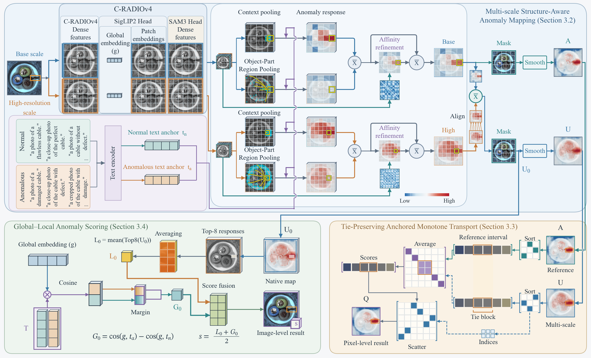

<div align="center">

# MSAT: Training-Free Zero-Shot Anomaly Detection via Multi-Scale Anchored Transport

[](LICENSE)
[](https://www.python.org/)
[](https://pytorch.org/)

**English** | [简体中文](README_zh.md)

[Overview](#overview) • [Method](#method) • [Main Results](#main-results) • [Installation](#installation) • [Quick Start](#quick-start) • [Citation](#citation)

</div>

Official implementation of **MSAT (Multi-Scale Anchored Transport)**, a training-free, sliding-window-free framework for zero-shot visual anomaly detection and localization. Using a frozen vision–language backbone (`C-RADIOv4-H`), MSAT produces both image-level anomaly scores and pixel-level anomaly maps without target-domain training images or parameter updates.

## Overview

Single-scale full-image encoding struggles to capture stable anomaly semantics and fine-grained local defects simultaneously. While a high-resolution branch recovers missed local details, direct cross-scale fusion distorts spatial response rankings and score distributions across images.

MSAT decouples pixel-level localization from image-level scoring over shared dual-scale evidence:
- **MSAM (Multi-Scale Structure-Aware Anomaly Mapping)** builds structure-aware anomaly fields at `448 × 448` and `672 × 672` by integrating SigLIP2-aligned semantics, SAM3-aligned object-part structure, and backbone content affinity.
- **AMT (Anchored Monotone Transport)** projects the multi-scale anomaly map onto the empirical distribution of the same image's base-scale map via a closed-form, tie-preserving 1D Wasserstein projection, calibrating score scales while preserving fine-grained spatial order.
- **GLAS (Global–Local Anomaly Scoring)** aggregates local upper-tail patch responses prior to transport and fuses them with the global anomaly margin to retain defect magnitudes for image-level detection.

<p align="center">
  
</p>

## Method

Given normal and anomalous text anchors $t_n$ and $t_a$, the anomaly margin for any normalized visual embedding $v$ is:

$$\mu(v) = \langle v, t_a \rangle - \langle v, t_n \rangle$$

1. **MSAM**: Extracts contextual neighborhood scores ($5 \times 5$ and $9 \times 9$), multi-granularity spherical $k$-means object-part scores ($K \in \{8, 32\}$), and content-affinity refined responses ($\tau = 0.1$). High-resolution responses are aligned onto the base grid via exact area-overlap aggregation and fused with $\alpha = 0.5$.
2. **AMT**: Produces the pixel-level anomaly map $Q$ via tie-preserving 1D optimal transport onto the same-image base-scale reference distribution $\hat{\nu}_A$:

   $$Q = \arg\min_{\tilde{Q} \in \mathcal{C}(U)} W_2^2(\hat{\nu}_{\tilde{Q}}, \hat{\nu}_A)$$

3. **GLAS**: Computes the image-level score directly from the pre-transport multi-scale grid $U_0$ ($M = 8$, $\lambda_G = 0.5$):

   $$s(x, c) = \lambda_G G_0 + (1 - \lambda_G)\operatorname{Mean}(\operatorname{Top}M(U_0))$$

## Main Results

We evaluate MSAT across **14 benchmarks** (7 industrial and 7 medical datasets, 66 categories, 20,277 images). Below are the domain-averaged results; full per-dataset breakdowns are in [results/table1.md](results/table1.md) and [results/table2.md](results/table2.md).

### Image-Level Anomaly Detection (Mean AUROC / max-F1 / AP, %)

| Method | Industrial (7 Datasets) | Medical (3 Datasets) |
| --- | :---: | :---: |
| CLIP | 84.2 / 78.7 / 81.7 | 91.9 / 88.7 / 91.8 |
| SAA+ | 67.9 / 72.3 / 67.6 | 50.5 / 71.2 / 50.7 |
| WinCLIP | 79.9 / 75.3 / 75.3 | 85.5 / 80.8 / 86.4 |
| FADE | 80.5 / 75.0 / 74.4 | – |
| DIVAD | 72.7 / 70.0 / 66.2 | 70.9 / 74.4 / 71.5 |
| MRAD-TF | 79.7 / 77.4 / 79.0 | 84.8 / 79.8 / 87.5 |
| RADIOlogy | 91.4 / 89.4 / 91.4 | 96.6 / 93.5 / 96.8 |
| **MSAT (Ours)** | **93.1 / 91.3 / 93.5** | **97.5 / 94.7 / 98.0** |

### Pixel-Level Anomaly Localization (Mean AUROC / max-F1 / AUPRO, %)

| Method | Industrial (7 Datasets) | Medical (4 Datasets) |
| --- | :---: | :---: |
| CLIP | 39.3 / 4.0 / 13.8 | 55.1 / 27.4 / 20.3 |
| SAA+ | 69.4 / 27.0 / 44.5 | 76.5 / 49.3 / 50.5 |
| WinCLIP | 77.9 / 14.8 / 47.5 | 69.2 / 33.5 / 36.4 |
| FADE | 91.7 / 30.1 / 78.2 | – |
| DIVAD | 91.7 / 29.6 / 76.1 | 72.0 / 34.9 / 44.8 |
| MRAD-TF | 88.4 / 22.9 / 62.1 | 78.2 / 41.1 / 57.0 |
| RADIOlogy | 94.5 / 36.9 / 84.5 | 86.2 / 53.1 / 65.6 |
| **MSAT (Ours)** | **95.1 / 37.9 / 85.5** | **86.4 / 53.2 / 65.9** |

## Installation

MSAT requires **Python 3.12+** and PyTorch matching your local CUDA environment (tested with PyTorch 2.8.0 and CUDA 12.8 on NVIDIA A40).

```bash
git clone https://github.com/liuweizz/MSAT.git
cd MSAT
pip install -r requirements.txt
pip install --no-deps .
```

Verify the CLI installation:

```bash
python -m amt1 --help
```

### Model Setup

MSAT uses frozen [C-RADIOv4-H](https://huggingface.co/nvidia/C-RADIOv4-H) and [SigLIP2](https://huggingface.co/google/siglip2-giant-opt-patch16-384) backbones. Follow [docs/assets.md](docs/assets.md) to prepare the checkpoints and configure `configs/assets.json`.

## Quick Start

### Single-Image Inference

```bash
python -m amt1 predict \
  --image /path/to/image.png \
  --category bottle \
  --assets configs/assets.json \
  --device cuda:0 \
  --output outputs/image.npz
```

The output `.npz` file saves the image-level score (`J`), global margin (`G`), native multi-scale response (`native`), base-scale reference map (`A`), unanchored map (`U`), and anchored map (`Q`).

### Dataset Preparation & Evaluation

We evaluate on 7 industrial datasets (`MVTec-AD`, `VisA`, `BTAD`, `MPDD`, `KolektorSDD`, `DAGM`, `DTD-Synthetic`) and 7 medical datasets (`HeadCT`, `BrainMRI`, `Br35H`, `ISIC`, `CVC-ClinicDB`, `CVC-ColonDB`, `TN3K`). See [docs/datasets.md](docs/datasets.md) for dataset setup, medical classification-only inference flags, and benchmark evaluation commands.

## Project Structure

```text
MSAT/
├── assets/          # Framework figure
├── configs/         # Hyperparameters (method.json) and asset/dataset configs
├── docs/            # Model setup and dataset evaluation guides
├── results/         # Full per-dataset comparison tables
├── scripts/         # Utility scripts
├── src/amt1/        # Core MSAT implementation (MSAM, AMT, GLAS)
└── third_party/     # Upstream components and notices
```

## Citation

If you find this repository helpful in your research, please consider citing:

```bibtex
@article{msat2026,
  title={MSAT: Training-Free Zero-Shot Anomaly Detection via Multi-Scale Anchored Transport},
  author={Liu, Weizhong and others},
  year={2026}
}
```

## Acknowledgements

This codebase builds upon [C-RADIO](https://github.com/NVlabs/RADIO), [SigLIP2](https://huggingface.co/google/siglip2-giant-opt-patch16-384), and [AdaCLIP](https://github.com/caoyunkang/AdaCLIP). We thank the authors for making their code and models publicly available.

## License

This project is released under the [Apache-2.0 License](LICENSE). Third-party models and code retain their respective licenses; see [third_party/NOTICES.md](third_party/NOTICES.md).
