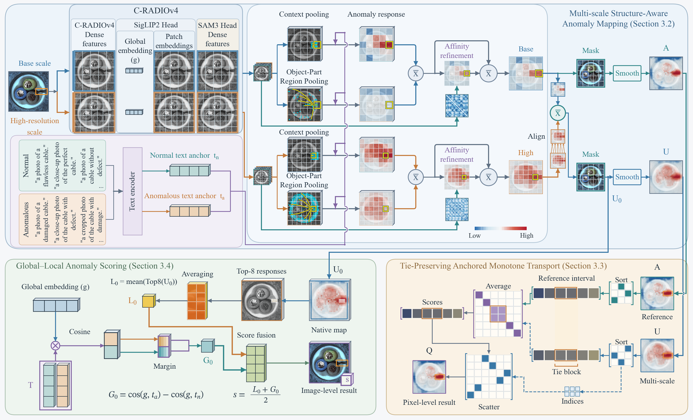

<div align="center">

# MSAT: Training-Free Zero-Shot Anomaly Detection via Multi-Scale Anchored Transport

[](LICENSE)
[](https://www.python.org/)
[](https://pytorch.org/)

[English](README.md) | **简体中文**

[简介](#简介) • [方法概览](#方法概览) • [主要结果](#主要结果) • [环境安装](#环境安装) • [快速开始](#快速开始) • [引用](#引用)

</div>

**MSAT（Multi-Scale Anchored Transport）** 的官方代码实现。MSAT 是一种无需训练、无需滑动窗口的多尺度零样本视觉异常检测框架，基于冻结的视觉–语言骨干网络（`C-RADIOv4-H`），在不使用目标域训练图像、不更新模型参数的情况下，同时输出图像级异常分数与像素级异常定位图。

## 简介

单尺度整图编码难以同时兼顾稳定的异常语义与细粒度的局部缺陷；而引入高分辨率分支后，直接跨尺度融合又会扰动空间排序与跨图分数分布。

MSAT 在共享的双尺度异常证据之上，将像素级定位与图像级判别解耦处理：
- **MSAM（多尺度结构感知异常映射）**：在 `448 × 448` 与 `672 × 672` 双尺度上融合 SigLIP2 对齐语义、SAM3 部件结构与骨干内容亲和性，构建共享的多尺度异常场。
- **AMT（锚定单调传输）**：通过满足保序与同值保持约束的一维 Wasserstein 闭式投影，将多尺度异常图映射到同图基础尺度参考分布上，兼顾细粒度空间排序与稳定的分数尺度。
- **GLAS（全局–局部异常评分）**：在传输前直接从原生多尺度网格中聚合局部高响应上尾均值，并与全局异常间隔融合，保留图像级判别所需的局部缺陷幅度。

<p align="center">
  
</p>

## 方法概览

记正常与异常文本锚点为 $t_n$ 与 $t_a$，任意归一化视觉特征 $v$ 的异常间隔定义为：

$$\mu(v) = \langle v, t_a \rangle - \langle v, t_n \rangle$$

1. **MSAM**：在双尺度分别计算局部邻域上下文分数（$5 \times 5$ 与 $9 \times 9$）、多粒度球面 $k$-means 部件区域分数（$K \in \{8, 32\}$）以及内容亲和性传播（$\tau = 0.1$）；高分辨率响应经精确面积重叠投影对齐至基础网格后按 $\alpha = 0.5$ 融合。
2. **AMT**：通过同图一维最优传输闭式解生成像素级异常图 $Q$：

   $$Q = \arg\min_{\tilde{Q} \in \mathcal{C}(U)} W_2^2(\hat{\nu}_{\tilde{Q}}, \hat{\nu}_A)$$

3. **GLAS**：在 AMT 之前直接基于原生多尺度网格 $U_0$ 计算图像级异常分数（$M = 8$，$\lambda_G = 0.5$）：

   $$s(x, c) = \lambda_G G_0 + (1 - \lambda_G)\operatorname{Mean}(\operatorname{Top}M(U_0))$$

## 主要结果

我们在 **14 个基准数据集**（7 个工业 + 7 个医疗，共 66 个类别、20,277 张图像）上评估 MSAT。下表为各领域平均指标，完整分数据集结果见 [results/table1.md](results/table1.md) 与 [results/table2.md](results/table2.md)。

### 图像级异常检测（平均 AUROC / max-F1 / AP，%）

| 方法 | 工业场景（7 个数据集） | 医疗场景（3 个数据集） |
| --- | :---: | :---: |
| CLIP | 84.2 / 78.7 / 81.7 | 91.9 / 88.7 / 91.8 |
| SAA+ | 67.9 / 72.3 / 67.6 | 50.5 / 71.2 / 50.7 |
| WinCLIP | 79.9 / 75.3 / 75.3 | 85.5 / 80.8 / 86.4 |
| FADE | 80.5 / 75.0 / 74.4 | – |
| DIVAD | 72.7 / 70.0 / 66.2 | 70.9 / 74.4 / 71.5 |
| MRAD-TF | 79.7 / 77.4 / 79.0 | 84.8 / 79.8 / 87.5 |
| RADIOlogy | 91.4 / 89.4 / 91.4 | 96.6 / 93.5 / 96.8 |
| **MSAT（本文）** | **93.1 / 91.3 / 93.5** | **97.5 / 94.7 / 98.0** |

### 像素级异常定位（平均 AUROC / max-F1 / AUPRO，%）

| 方法 | 工业场景（7 个数据集） | 医疗场景（4 个数据集） |
| --- | :---: | :---: |
| CLIP | 39.3 / 4.0 / 13.8 | 55.1 / 27.4 / 20.3 |
| SAA+ | 69.4 / 27.0 / 44.5 | 76.5 / 49.3 / 50.5 |
| WinCLIP | 77.9 / 14.8 / 47.5 | 69.2 / 33.5 / 36.4 |
| FADE | 91.7 / 30.1 / 78.2 | – |
| DIVAD | 91.7 / 29.6 / 76.1 | 72.0 / 34.9 / 44.8 |
| MRAD-TF | 88.4 / 22.9 / 62.1 | 78.2 / 41.1 / 57.0 |
| RADIOlogy | 94.5 / 36.9 / 84.5 | 86.2 / 53.1 / 65.6 |
| **MSAT（本文）** | **95.1 / 37.9 / 85.5** | **86.4 / 53.2 / 65.9** |

## 环境安装

需要 **Python 3.12+** 及匹配本机 CUDA 的 PyTorch（测试环境：NVIDIA A40，PyTorch 2.8.0，CUDA 12.8）。

```bash
git clone https://github.com/liuweizz/MSAT.git
cd MSAT
pip install -r requirements.txt
pip install --no-deps .
```

验证安装：

```bash
python -m amt1 --help
```

### 模型权重准备

MSAT 使用冻结的 [C-RADIOv4-H](https://huggingface.co/nvidia/C-RADIOv4-H) 与 [SigLIP2](https://huggingface.co/google/siglip2-giant-opt-patch16-384) 权重。请参照 [docs/assets.md](docs/assets.md) 下载权重并配置 `configs/assets.json`。

## 快速开始

### 单图推理

```bash
python -m amt1 predict \
  --image /path/to/image.png \
  --category bottle \
  --assets configs/assets.json \
  --device cuda:0 \
  --output outputs/image.npz
```

输出 `.npz` 文件包含图像级分数（`J`）、全局间隔（`G`）、原生多尺度响应（`native`）、参考图（`A`）、未锚定图（`U`）与锚定异常图（`Q`）。

### 数据准备与基准评测

涵盖 7 个工业数据集（`MVTec-AD`、`VisA`、`BTAD`、`MPDD`、`KolektorSDD`、`DAGM`、`DTD-Synthetic`）与 7 个医疗数据集（`HeadCT`、`BrainMRI`、`Br35H`、`ISIC`、`CVC-ClinicDB`、`CVC-ColonDB`、`TN3K`）。完整数据目录结构、医疗分类推理参数及全量评测命令见 [docs/datasets.md](docs/datasets.md)。

## 目录结构

```text
MSAT/
├── assets/          # 方法框架图
├── configs/         # 方法超参数（method.json）与模型/数据配置
├── docs/            # 模型权重与数据集评测说明
├── results/         # 分数据集完整结果表
├── scripts/         # 辅助脚本
├── src/amt1/        # MSAT 核心实现（MSAM、AMT、GLAS）
└── third_party/     # 第三方组件与声明
```

## 引用

如果本工作对你的研究有帮助，欢迎引用：

```bibtex
@article{msat2026,
  title={MSAT: Training-Free Zero-Shot Anomaly Detection via Multi-Scale Anchored Transport},
  author={Liu, Weizhong and others},
  year={2026}
}
```

## 致谢

本项目基于 [C-RADIO](https://github.com/NVlabs/RADIO)、[SigLIP2](https://huggingface.co/google/siglip2-giant-opt-patch16-384) 与 [AdaCLIP](https://github.com/caoyunkang/AdaCLIP) 构建，感谢相关作者的开源贡献。

## 许可证

本项目代码遵循 [Apache-2.0](LICENSE) 许可证开源。第三方代码与模型遵循其各自许可证，详见 [third_party/NOTICES.md](third_party/NOTICES.md)。
